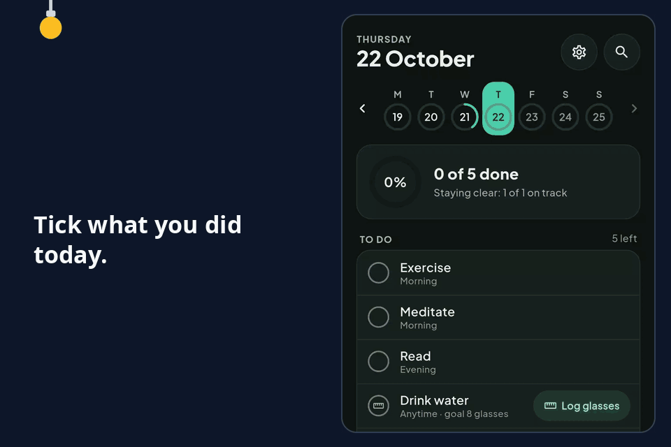

# Daily Tracker

A habit tracker for Android. It works offline, keeps its data on your phone, and stays out of your way: open it, tick
what you did, close it.

**[Download the latest APK (v2.0.3) →](https://github.com/pctablet505/daily_tracker/releases/latest)**

A real screen recording on a Pixel 9, 21 to 22 October 2026, of v2.0.3 built from its tag as a separate demo copy.

## What you get

- **Today, in one tap.** Every habit planned for the day, and one tap to tick it, type a number, add a note or take a
  photo.
- **Streaks you can trust.** A day keeps the streak when at least 60% of its planned habits are done (you can change
  the share). For a habit you stay clear of, a day you never opened the app does not count as clean, and today never
  breaks a streak while it is still open.
- **Reminders.** A time per habit, quiet hours, and buttons on the notification to mark it done or
  ask again in an hour.
- **Your data, your copies.** Save a backup file anywhere and restore from it, or back up to your own
  Google Drive app folder in builds set up for it. Photos are in no backup.
- **Updates you can check.** Every release from v2.0.0 on ships a `.sha256` file, and the app refuses an update that does not match it.

## Install

1. Download `daily-tracker-2.0.3.apk` and `daily-tracker-2.0.3.apk.sha256` from the
   [latest release](https://github.com/pctablet505/daily_tracker/releases/latest).
2. Check the download: `sha256sum -c daily-tracker-2.0.3.apk.sha256` prints `daily-tracker-2.0.3.apk: OK`.
3. Open the APK on your phone and allow the install.

After that, the app checks this repository's releases itself and offers each update.

## Limits

- **Android only.** There are no iOS, web or desktop builds.
- **A habit tracker, not a to-do list.** No one-off tasks, due dates or task priorities.
- **Photos stay on the phone.** They are in no backup; only a direct phone-to-phone transfer moves them.
- **The cloud backup needs set-up.** It stays off until the build is given an OAuth client; the backup file works
  without it.

## Where next

- [The full guide](docs/details.md): every feature, building and testing it, the release and signing steps, and the
  backup set-up.
- [Releases](https://github.com/pctablet505/daily_tracker/releases): every version; each one from v2.0.0 on has its checksum.

MIT License, see [LICENSE](LICENSE).

---

<picture><source media="(prefers-color-scheme: dark)" srcset="assets/mark-dark.svg"></picture>
Built by [pctablet505](https://github.com/pctablet505).
